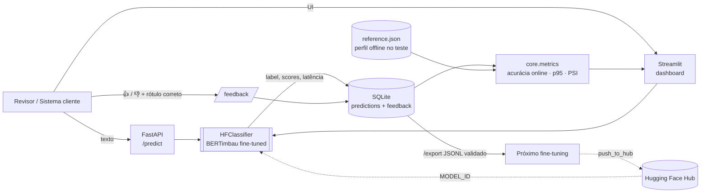

# ⚖️ Legal NLP Feedback Engine

[](https://github.com/julio-dourado/legal-nlp-feedback-engine/actions/workflows/ci.yml)
[](https://huggingface.co/juliodourado1/bertimbau-legal-judgment-ptbr)
[](https://huggingface.co/spaces/juliodourado1/legal-nlp-feedback-engine)

Um modelo em produção precisa de mais do que `model.predict()`. Este projeto mostra **o ciclo completo de
um classificador de NLP jurídico em português**: servir o modelo, registrar cada predição, coletar a
validação de especialistas (*human-in-the-loop*), monitorar a qualidade online e transformar as correções
em dados para o próximo fine-tuning.

A arquitetura reproduz, com dados públicos e código escrito do zero, o padrão em que trabalhei no
**Projeto Sabiá (AI.lab UnB / Tribunal Superior do Trabalho)**: backend FastAPI, endpoints de feedback de
modelos e painéis Streamlit de observabilidade. Nenhum código ou dado do TST foi usado.

## O que ele faz

| Etapa | Como |
|---|---|
| **Inferência** | [BERTimbau fine-tuned](https://huggingface.co/juliodourado1/bertimbau-legal-judgment-ptbr) prevê se um recurso foi *provido*, *parcialmente provido* ou *não provido* a partir da descrição da decisão |
| **Registro** | Toda predição vai para o SQLite com texto, scores, latência e versão do modelo (`model_id@commit`) |
| **Human-in-the-loop** | O revisor marca 👍/👎 e, se errado, informa o rótulo correto (upsert: a última revisão vale) |
| **Observabilidade** | Acurácia online (a partir do feedback), latência p50/p95 e **drift via PSI** da confiança e do mix de rótulos contra o perfil offline do modelo no conjunto de teste |
| **Re-treino** | `GET /export` gera JSONL só com exemplos validados por humanos, pronto para o próximo fine-tuning |

## Arquitetura



`core/` é compartilhado: a API e o dashboard usam as mesmas classes (`HFClassifier`, `Store`, `snapshot`),
então a lógica de negócio é testada uma vez, sem depender do modelo real (os testes injetam um
classificador falso via `dependency_overrides` do FastAPI).

## Detecção de drift

Para cada janela das últimas 200 predições, o PSI (*Population Stability Index*) compara a distribuição de
produção com a de referência, gerada por `scripts/build_reference.py` rodando o modelo no conjunto de teste:

$$\mathrm{PSI} = \sum_i (a_i - e_i)\,\ln\frac{a_i}{e_i}$$

* **Confiança** (10 bins entre 0 e 1): queda de confiança costuma anteceder queda de acurácia, e não exige rótulo.
* **Mix de rótulos previstos**: mudança no tipo de processo que chega ao sistema.

PSI < 0,1 estável · 0,1–0,25 moderado · > 0,25 significativo. Abaixo de 20 predições o status é
`insufficient data`, para não gerar alarme com amostra pequena.

## Rodando localmente

```bash
pip install -r requirements-dev.txt
pytest -q                                   # testes (não baixam o modelo)

uvicorn api:app --reload                    # API → http://localhost:8000/docs
streamlit run app.py                        # dashboard → http://localhost:8501

# ou com Docker (mesma imagem do HF Space)
docker build -t legal-nlp-feedback-engine . && docker run -p 7860:7860 legal-nlp-feedback-engine
```

```bash
curl -s localhost:8000/predict -H 'content-type: application/json' \
  -d '{"text": "APELAÇÃO CÍVEL. MANDADO DE SEGURANÇA. SERVIDOR PÚBLICO. SUPRESSÃO DE GRATIFICAÇÃO SEM CONTRADITÓRIO."}'
# {"prediction_id": 1, "label": "no", "confidence": 0.87, ...}

curl -s localhost:8000/feedback -H 'content-type: application/json' \
  -d '{"prediction_id": 1, "is_correct": false, "corrected_label": "partial"}'

curl -s localhost:8000/metrics
```

Variáveis: `MODEL_ID` (padrão `juliodourado1/bertimbau-legal-judgment-ptbr`), `DB_PATH`, `REFERENCE_PATH`.

## Estrutura

```
core/model.py      HFClassifier: tokeniza, infere, mede latência e versiona o modelo
core/store.py      SQLite: predições, feedback (upsert) e export para re-treino
core/metrics.py    acurácia online, latência, PSI e status de drift
api.py             FastAPI: /predict /feedback /metrics /export /health
app.py             Streamlit: classificar, revisar, observar, baixar dataset
scripts/           build_reference.py — perfil offline + exemplos do conjunto de teste
tests/             testes da API e das métricas com classificador falso
```

## Limitações

* SQLite atende a demo; em produção a troca natural é PostgreSQL (o `Store` isola o acesso).
* No HF Space o banco é efêmero e reinicia junto com o container.
* O modelo prevê o desfecho a partir de ementas do TJAL; não é aconselhamento jurídico e não foi validado em outros tribunais.

---
Feito por **Julio Cesar Almeida Dourado** · [LinkedIn](https://linkedin.com/in/juliodourado) · [Hugging Face](https://huggingface.co/juliodourado1)
